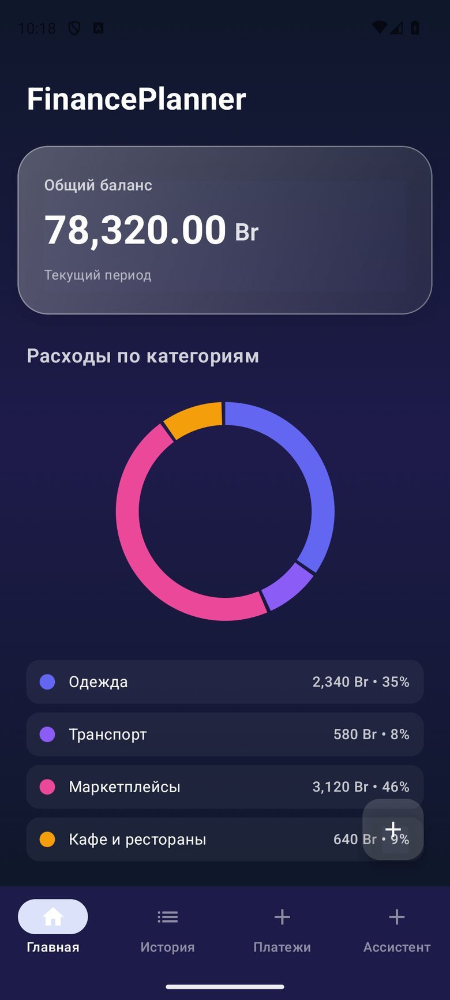
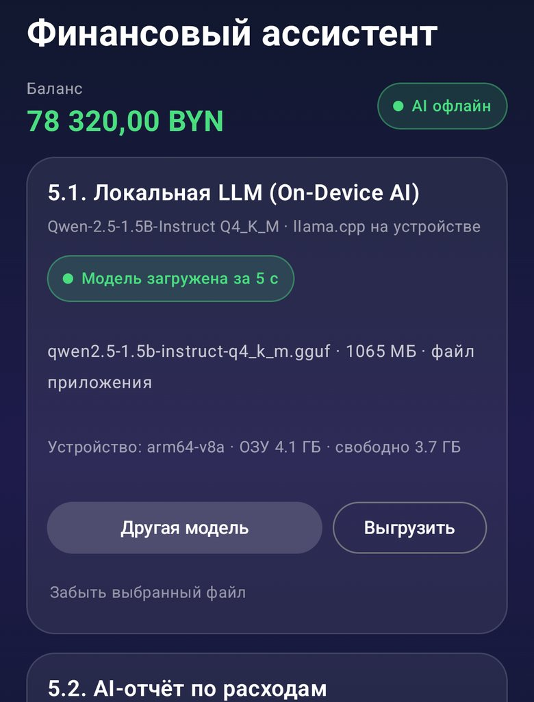
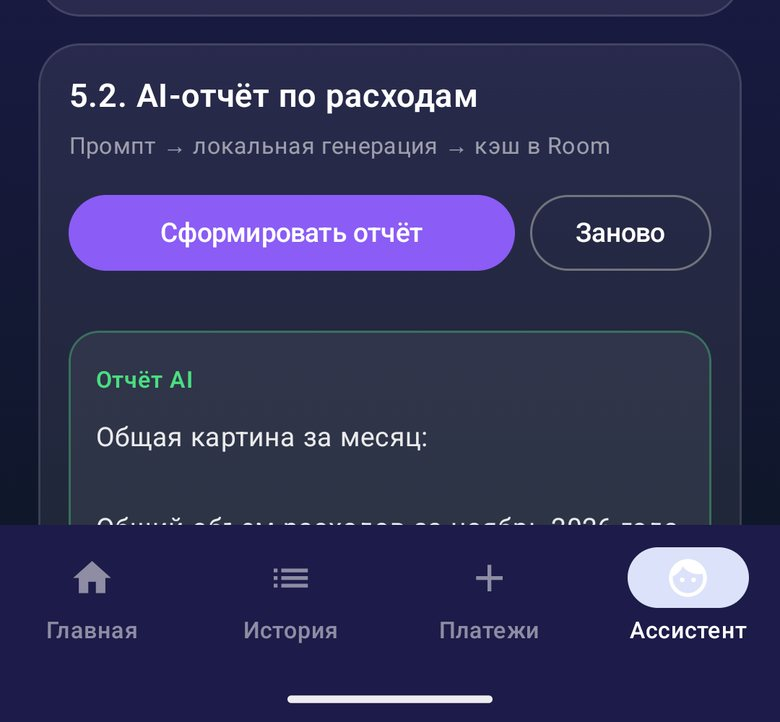
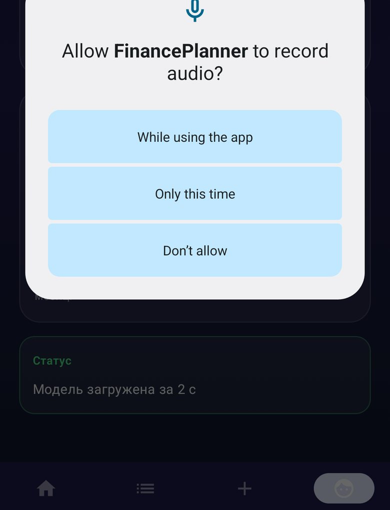
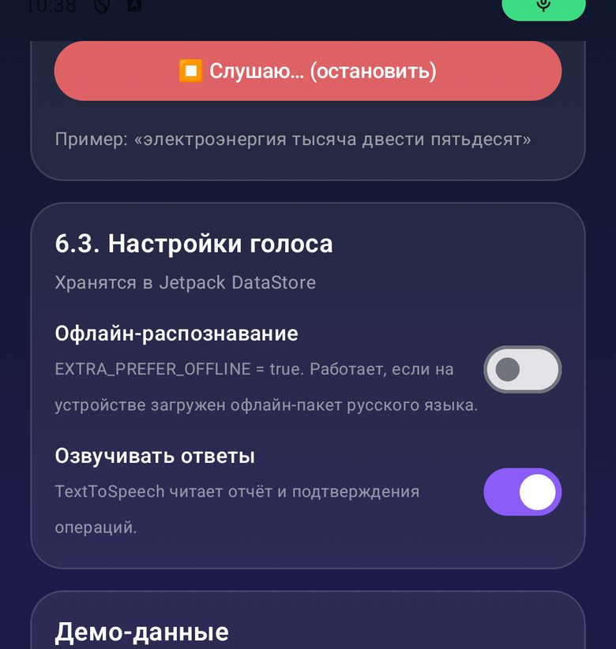

# FinancePlanner — Android-приложение для финансового планирования

Учебный проект по дисциплине «Разработка мобильных приложений» (вариант 4):
мобильное приложение для учёта личных финансов с импортом банковских выписок,
локальным AI-ассистентом на базе LLM и голосовым интерфейсом.

**Стек:** Kotlin · Jetpack Compose · Material 3 · MVVM + UDF · Room · Jetpack DataStore ·
kotlinx.serialization · Koin · Coroutines/Flow · llama.cpp (llamacpp-kotlin) · Qwen-2.5-1.5B-Instruct (GGUF)
· SpeechRecognizer · TextToSpeech.

---

## Возможности

| № | Функция | Экран |
|---|---------|-------|
| 1 | Баланс кошелька, список транзакций, фильтр по категориям, круговая диаграмма расходов | «Главная» / «История» |
| 2 | Карточка транзакции: сумма, дата и время, MCC-код с расшифровкой и иконкой, счёт | Детали операции |
| 3 | Импорт банковской выписки JSON через `ActivityResultContracts.OpenDocument`, сопоставление MCC по справочнику из `assets` | «Платежи» |
| 4 | **AI-отчёт по расходам**: локальная LLM анализирует траты за месяц и сравнивает с прошлым | «Ассистент» |
| 5 | **Голос: добавление траты** — «потратила двадцать пять рублей на такси» → запись в Room + озвучивание остатка | «Ассистент» |
| 6 | **Голос: показания счётчиков** — «электроэнергия тысяча двести пятьдесят» → сохранение + озвучивание разницы с прошлым месяцем | «Ассистент» |



---

## Лабораторные №5 и №6 — что и где реализовано

### ЛР №5. Интеграция LLM (On-Device AI)

| Требование | Файл |
|---|---|
| `LlmRepository` — абстракция над `LlamaHelper` | `data/ai/LlmRepository.kt`, `data/ai/LlmContracts.kt` |
| `LlmRepositoryImpl` — загрузка GGUF и генерация | `data/ai/LlmRepositoryImpl.kt` |
| UseCase: промпт, вызов, постобработка | `domain/usecase/AnalyzeExpensesUseCase.kt`, `data/ai/LlmTextPostProcessor.kt` |
| Состояния Loading / Success / Error через `StateFlow` | `ModelStatus`, `GenerationStatus` |
| Кэш результатов в Room | `data/local/LlmCacheEntity.kt`, `LlmCacheDao.kt` |
| Офлайн-работа, проверка совместимости, graceful degradation | `data/ai/ModelProvider.kt`, `DeviceCompatibility` |
| Освобождение нативных ресурсов | `LlmRepositoryImpl.release()`, `MainActivity.onDestroy()` |




### ЛР №6. Голосовой интерфейс (STT + TTS)

| Требование | Файл |
|---|---|
| `VoiceRepository` — абстракция над `SpeechRecognizer` и `TextToSpeech` | `data/voice/VoiceRepository.kt` |
| `VoiceRepositoryImpl` — инициализация, прослушивание, озвучивание | `data/voice/VoiceRepositoryImpl.kt` |
| Состояния `Idle` / `Listening` / `Processing` / `Error` | `VoiceUiState`, `VoiceErrorKind` |
| Изоляция от UI (никаких вызовов из Composable) | `ui/screens/assistant/AssistantViewModel.kt` |
| Освобождение ресурсов в `onCleared()` | `AssistantViewModel.onCleared()` → `destroy()` |
| Обработка ошибок (нет разрешения, микрофон занят, нет сервиса, язык) | `VoiceRepositoryImpl.describeRecognizerError()` |
| Парсинг чисел из голоса (цифры и числительные) | `domain/util/VoiceNumberParser.kt` |
| Сценарии варианта 4 | `ParseExpenseVoiceUseCase`, `AddVoiceExpenseUseCase`, `RecordMeterReadingUseCase` |





---

## Архитектура

```
app/src/main/java/com/example/financeplanner/
├── MainActivity.kt / FinancePlannerApp.kt   точка входа, старт Koin
├── di/AppModule.kt                          Koin: Room, DataStore, репозитории, use case, ViewModel
├── data/
│   ├── ai/         LlmRepository, LlmRepositoryImpl, ModelProvider, постобработка
│   ├── local/      Room: TransactionEntity/Dao, WalletEntity/Dao, LlmCacheEntity/Dao,
│   │               MeterReadingEntity/Dao, AppDatabase (v3 + миграции)
│   ├── prefs/      SettingsRepository (DataStore: URI модели, офлайн-распознавание, озвучка)
│   ├── remote/dto/ DTO выписки и MCC (kotlinx.serialization)
│   ├── repository/ FinanceRepository, MccRepository (JSON из assets), MeterRepository
│   └── voice/      VoiceRepository, VoiceRepositoryImpl
├── domain/
│   ├── model/      MeterType, MccProvider, MeterStore
│   ├── usecase/    AnalyzeExpenses, ParseExpenseVoice, AddVoiceExpense, RecordMeterReading,
│   │               SeedDemoData
│   └── util/       VoiceNumberParser, RussianPlurals
└── ui/
    ├── components/ BalanceCard, ExpensePieChart, TransactionItem
    ├── navigation/ AppNavigation
    ├── screens/    home, detail, payments, assistant
    └── theme/      Color, Theme, Type
```

Поток данных строго однонаправленный: Composable → ViewModel → use case → репозиторий →
`StateFlow` → Composable. Платформенные классы (`SpeechRecognizer`, `TextToSpeech`, `LlamaHelper`)
не вызываются из UI.

---

## Сборка

Требуется **JDK 17** и Android SDK 36 (`compileSdk = 36`, `minSdk = 26`).

```bash
# небольшой APK (~30 МБ, модель выбирается на устройстве) — основной вариант
./gradlew :app:assembleDebug

# APK со встроенной моделью (~1.1 ГБ, модель копируется при первом запуске)
./gradlew :app:assembleDebug -PbundleModel=true
```

Юнит-тесты (29 штук: парсер чисел, склонения, промпт/кэш LLM, сценарии счётчиков):

```bash
./gradlew :app:testDebugUnitTest
```

---

## Модель

Используется **Qwen-2.5-1.5B-Instruct, GGUF Q4_K_M** (~1.07 ГБ). Приложение работает
**полностью офлайн**: модель не скачивается из интернета. Файл попадает на устройство одним из способов:

1. **Выбрать в приложении** («Ассистент» → «Выбрать GGUF-файл», SAF `OpenDocument`).
   Приложение запоминает выбор в DataStore и больше не спрашивает.
2. **Положить в приватную папку приложения** `files/models/` (удобно через `adb push`).
3. **Собрать APK с моделью** (`-PbundleModel=true`) — при первом запуске она копируется
   из `assets/models/` во внутреннюю память.

Исходный GGUF лежит в `app/model-assets/models/` и **не** попадает в обычную сборку
(папка подключается как assets только при `-PbundleModel=true`).

Загрузка модели: ~5–15 с на телефоне, ~1,2 ГБ ОЗУ. Проверка совместимости (ABI `arm64-v8a`,
ОЗУ ≥ 3 ГБ, свободное место) выполняется перед загрузкой; при нехватке ресурсов AI-функция
отключается с понятным сообщением, остальные экраны работают.

---

## Передача на телефон и запуск

Подробная пошаговая инструкция — в файле [`docs/КАК_ЗАПУСТИТЬ.md`](docs/КАК_ЗАПУСТИТЬ.md).

Коротко (вариант с отдельным файлом модели):

1. Перекинуть на телефон `dist/FinancePlanner-lab5-6.apk` и
   `qwen2.5-1.5b-instruct-q4_k_m.gguf` (например, в папку `Download`).
2. Установить APK (разрешить установку из неизвестных источников), открыть приложение.
3. «Ассистент» → «Выбрать GGUF-файл» → выбрать `qwen2.5-1.5b-instruct-q4_k_m.gguf`
   → модель загрузится и останется выбранной.

Коротко (вариант «всё в одном»): установить `dist/FinancePlanner-lab5-6-with-model.apk`,
открыть «Ассистент», дождаться копирования модели из APK.

---

## Демонстрация преподавателю (3–4 минуты)

1. **Главная** — баланс, диаграмма, фильтр по категориям, открыть карточку транзакции
   (MCC-код, дата и время, счёт).
2. **Платежи** → «Импортировать выписку» → выбрать `sample_statement.json`
   (лежит в `Download` или в `app/src/main/assets/`) → операции появились в списке.
3. **Ассистент** → внизу «Добавить демо-операции» (если база пустая) →
   «Сформировать отчёт» → модель печатает отчёт локально, затем озвучивает его.
   Повторное нажатие «Сформировать отчёт» отдаёт ответ из кэша Room (бейдж «Отчёт из кэша»).
4. **Голос** → «Добавить трату голосом»: «потратила двадцать пять рублей на такси» →
   приложение сохраняет трату и озвучивает остаток баланса.
5. **Голос** → «Продиктовать показания»: «электроэнергия тысяча двести пятьдесят» →
   сохраняет показание и озвучивает разницу с прошлым месяцем.

---

## Хранение данных

| Хранилище | Что хранится |
|---|---|
| **Room** (`finance_database`, v3) | транзакции, кошельки, кэш ответов LLM (`llm_cache`), показания счётчиков (`meter_readings`) |
| **assets/mcc_codes.json** | справочник MCC-кодов: id, название категории, иконка |
| **Jetpack DataStore** | URI выбранной модели, режим офлайн-распознавания, включение озвучки |
| **kotlinx.serialization** | разбор банковской выписки и справочника MCC |

---

## Ограничения и особенности

- llama.cpp в `llamacpp-kotlin` собран только под **arm64-v8a** — на x86-эмуляторе AI-функция
  покажет сообщение о неподдерживаемой архитектуре, остальное приложение работает.
- `LlamaHelper` не позволяет задать параметры генерации, поэтому длина ответа ограничивается
  промптом и обрезкой по служебному токену `<|im_end|>`; в отчёте около 130–250 слов.
- Генерация: ~10–15 ток/с на эмуляторе, обычно 20–60 с на отчёт; на телефоне быстрее.
- Распознавание речи зависит от установленной службы STT. Русский язык и офлайн-пакет
  проверяются; при их отсутствии показывается понятное сообщение, ручной ввод остаётся доступен.
- Интернет приложению нужен только для онлайн-распознавания речи (служба Google),
  сама LLM и все данные — локальные.
